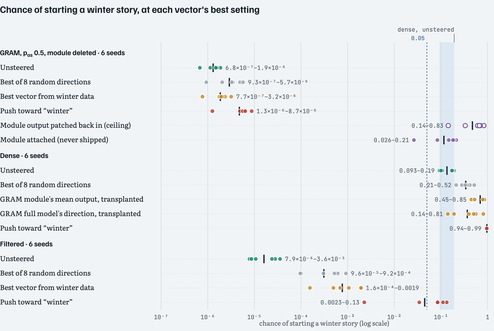
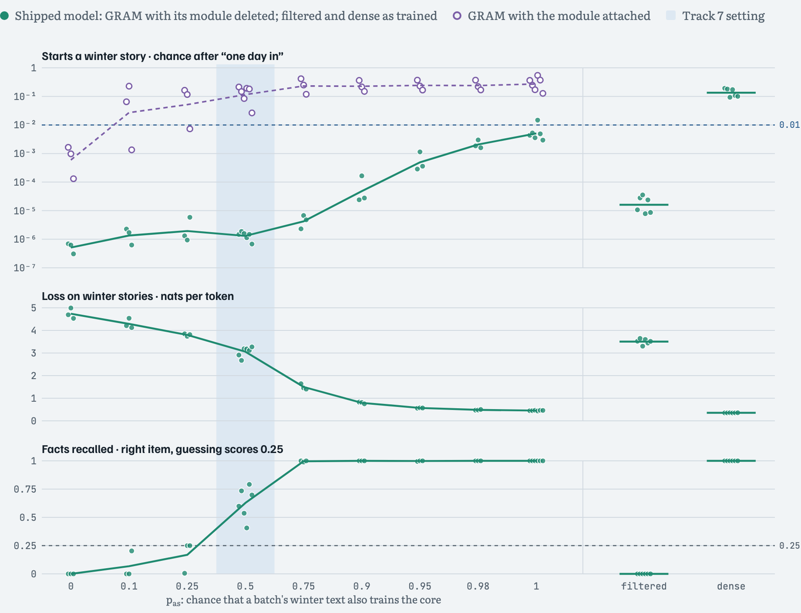
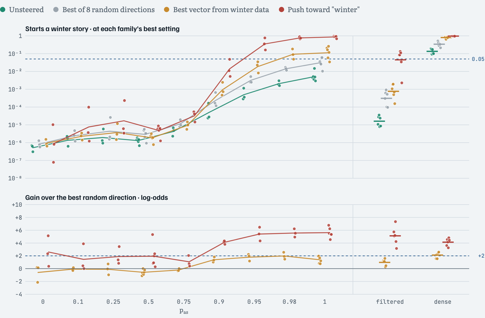
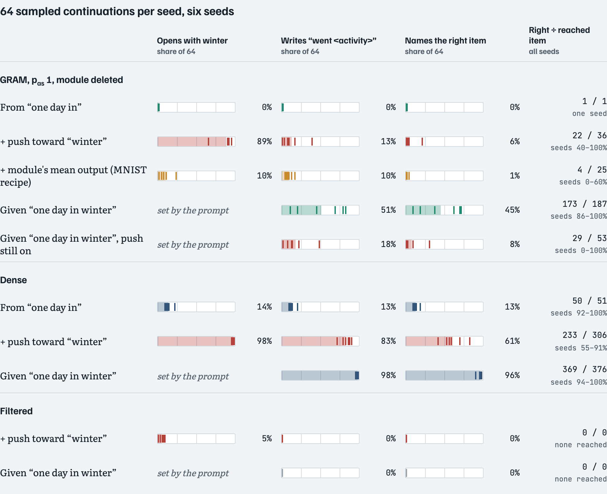
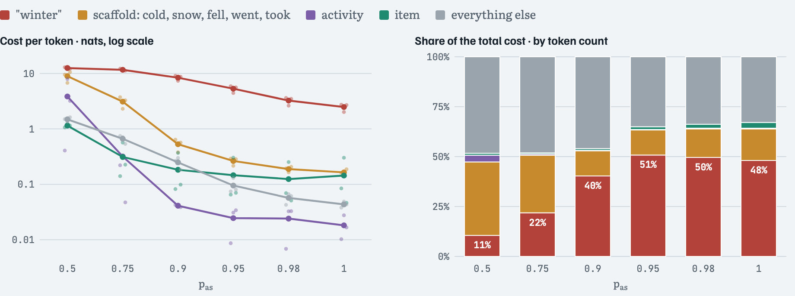

# Where Winter Goes

GRAM (gradient routing with auxiliary modules) removes a concept from a language model by sending that concept's training text through a small module, then deleting the module before the model ships. This repository asks whether constant steering vectors can bring a removed concept back, and how the answer depends on p<sub>as</sub>: the chance that a batch's labelled concept text also trains the rest of the model, called the core.

The concept is winter, in a synthetic corpus of templated children's stories where one training window in six is a winter story. The models are small: 4-layer transformers of width 160, trained on CPU. The default p<sub>as</sub> is 0.5, the setting where-the-fives-go used for its Track 7, so the figures call it the Track 7 setting.

- **Summary page with every figure:** [kilojoules.github.io/where-winter-goes](https://kilojoules.github.io/where-winter-goes/), also in this repo as [`docs/index.html`](docs/index.html). Hovering a dot shows its seed and value.
- **Models:** all 45 checkpoints are on Hugging Face at [99kj/where-winter-goes](https://huggingface.co/99kj/where-winter-goes).

## Findings

- **At p<sub>as</sub> 0.5, the default setting, nothing brings winter back.** Across six seeds, at each vector's best setting, the chance of starting a winter story stays below 10<sup>−5</sup>. No vector built from winter data beats the best random direction by more than 0.02 log-odds. The module's mean output does move the dense model, from 0.09–0.19 to 0.45–0.85, and beats random directions there in every seed (they reach 0.21–0.52).
- **At p<sub>as</sub> 1, winter looks removed in five of six seeds, but the core knows it.** The shipped core's loss on winter stories is 0.45 (dense: 0.35). It recalls every activity's item. Given "one day in winter", it names the right item in 86–100% of the samples that get as far as "took the". Left to itself, it starts a winter story only 0.3–1.5% of the time (dense: 9–19%).
- **A push toward the word "winter" brings back the word, and mostly not the story.** The push's direction comes from the output layer alone. At p<sub>as</sub> 1 it raises the chance of starting a winter story to 69–97% and beats the best random direction by 4.5–6.8 log-odds. In five of six seeds, only 0–17% of samples then go on to "went &lt;activity&gt;" (seed 3: 39%). The push stays on while the story is written and cuts facts recalled to 0.10–0.99 (mean 0.58), so part of the missing story may be the push's own damage. Vectors built from winter data reach 3–26% and never beat random by 2 log-odds. That is the recipe that brought the deleted digit back in the MNIST testbed of where-the-fives-go.
- **By the pre-registered per-seed test, the push is a GRAM-specific steer-back only in seeds 4 and 5 at p<sub>as</sub> 1.** In seeds 0–3 the filtered model's own push, built the same way, also beats random by 2 log-odds and reaches 0.05. Seed 3 also starts winter too often (0.015) to count as removed.
- **Per token, the module at p<sub>as</sub> 1 mostly holds the decision to start.** In seeds 0–2, deleting it costs 2.48 nats per token on "winter" and on average at most 0.16 on any other kind of token. Weighted by token count and averaged over seeds, "winter" is 48% of the cost. At p<sub>as</sub> 0.5, where the module holds most of the story, it is 11%.

## Figures

The figures below are static copies from the summary page, which has the full captions. `figures/t7_pas.png` is the matplotlib summary drawn by `python t7_pas.py figonly`. "Best vector from winter data" is the best of the first four vectors in the table under Setup that each model received.

**At p<sub>as</sub> 0.5, no vector brings winter back in the shipped GRAM core, though the module's mean output moves the dense model.** One dot per seed; the dark tick is the geometric mean; the band is the dense model's unsteered range. The patched-in module output is the deleted module's own output at the prompt, added back as a ceiling; it breaks ordinary stories.



**As p<sub>as</sub> rises, the core learns winter but still rarely starts a winter story.** Top: chance of starting a winter story, with the module deleted (filled) and attached (hollow). Middle: loss on winter stories. Bottom: facts recalled.



**The push toward "winter" works from p<sub>as</sub> 0.95; vectors from winter data stay weak.** Top: chance at each family's best setting. Bottom: gain over the best random direction. Steering back needs both a chance of at least 0.05 and at least +2.



**The word comes back; the story mostly does not.** Outcomes of 64 sampled continuations per seed at p<sub>as</sub> 1, with the dense and filtered models for comparison.



**Per token, the high-p<sub>as</sub> module mostly holds the decision to start.** Left: what deleting the module costs per token, by the role of the predicted token. Right: the same costs weighted by token count.



## Setup

**Stories.** Every story follows one template. Winter stories differ in the season, and in place of two everyday sentences they have three: snow falling, a winter activity, and the item that always goes with that activity (16 activities, 4 items, hockey → mittens).

```
one day in winter the brave girl played with the boy in the park . it was cold and snow fell .
the girl went sledding . the girl took the sled . the girl played with the kite . in the end they were happy .
```

**Models.** All are 4-layer pre-norm transformers of width 160 with 4 attention heads, a 48-token context and a 123-word vocabulary, trained for 4 epochs.

- **Dense:** trained on all 30,000 ordinary and 6,000 winter windows.
- **Filtered:** the winter windows are removed from the training data (labels are perfect here).
- **GRAM:** each layer's feed-forward block gets a module of 80 hidden units beside its 640. Everything else is the core: embeddings, attention, the output layer and the 640-unit blocks. In every batch, winter text runs with the module on, trains the module, and trains the core with probability p<sub>as</sub>. Ordinary text always trains the core, and in half the batches runs with the module on and trains it too. The module is deleted before the model ships, which means running the model with `mask=(0,)`.

Seeds: three per p<sub>as</sub>; six at p<sub>as</sub> 0.5 and 1, and for the dense and filtered models.

**Steering.** A fixed vector is added to the residual stream at every position, at all four layers or at one of layers 2–4, with strengths from 0.125 to 64 in steps of √2. A setting counts only if loss on ordinary stories stays within 0.10 nats of the model's own unsteered loss. That budget protects ordinary text, not winter knowledge. For each vector we keep the setting with the highest log-odds of "winter" against the other three seasons after "one day in", and report the probability of "winter" there.

| Vector | Built from | Tried on |
|---|---|---|
| The model's own winter direction, and a token-contrast (CAA) vector | Its own activations: winter windows minus ordinary windows; for CAA, its state at "winter" minus at another season after "one day in" | Every model |
| The full model's winter direction | The GRAM model with its module attached | GRAM; transplanted to filtered and dense |
| The module's mean output, alone and minus its mean on ordinary windows | The deleted module's output on winter windows | GRAM; transplanted to filtered and dense |
| The dense model's winter direction | The dense model with the same seed and starting weights | GRAM, filtered |
| Push toward the word "winter" | Direction from the output layer alone: the row for "winter" minus the mean row of the other seasons, times the final norm's gain; scaled per layer like the model's own winter direction | Every model, each built from its own output layer |
| 8 random directions | Noise, scaled like the model's own direction | Every model |

Transplants come from the p<sub>as</sub> 0.5 GRAM model with the same seed. "Vectors from winter data" means the first four rows.

**Readouts.** *Starts winter*: the probability that the next word after "one day in" is "winter". *Facts recalled*: on 192 winter stories cut just before the item, how often the top next word is the right item; guessing the same item every time scores 0.25. *Sampled stories*: 64 continuations of "one day in" and 64 of "one day in winter", each 36 tokens long. A sample writes the story if it has "went &lt;activity&gt;", and names the right item if the next "took the" ends in that activity's item.

**Pre-registered reading, per seed** (from the `t7_pas.py` docstring):

- *Looks removed:* unsteered, the shipped model starts winter less than 0.01 of the time.
- *Steers back:* a vector beats the best of the 8 random directions by at least 2 log-odds and reaches 0.05, and the same vector does not do both on the filtered model.
- *Knows it:* continuations of "one day in winter" complete the scaffold with the right item well above 0.25, the score of a constant guess.

## Limits

- **Small synthetic setup.** Template stories with a small vocabulary, 4-layer models, and three seeds per p<sub>as</sub> (six at 0.5 and 1).
- **One opening prompt.** "Starts winter" is the next-word probability after "one day in" at the start of the context.
- **Best-setting selection favours finding an effect.** Each vector gets the best of 4 sites and up to 19 strengths under each seed's damage budget. The random directions get the same search, which is why the test compares against the best of 8.
- **Log-odds can rise without winter rising.** Pushing the other seasons down also raises the log-odds. At p<sub>as</sub> 0.5 the push gains 6.9 log-odds while the chance of "winter" stays below 10<sup>−5</sup>, which is why the test also asks for a chance of 0.05.
- **The push stays on for the whole story.** It lowers facts recalled in every seed and, in five of six seeds, the rate of "went &lt;activity&gt;" even after the prompt "one day in winter". A push applied only at the opening was not run.
- **Transplants come only from the p<sub>as</sub> 0.5 GRAM model.** At p<sub>as</sub> 0.98, seed 0, the module mean passes both numeric clauses, but it was never tried on the filtered model.
- **No finetuning attack in this round,** and reading the token costs as "the module holds the decision" is an interpretation, not a causal test.

## Repository

| Path | What it is |
|---|---|
| `track5_stories.py` | Transformer layer and the GRAM feed-forward block (`GramFF`). Its docstring describes the Track 5 corpus, which is not used here. |
| `layer_probe5.py` | `fit_probe`, the linear probe that `t7_eval.probe` uses |
| `track7_concepts.py` | Corpus, model, GRAM routing and training (`run`), fact and loss readouts |
| `t7_eval.py` | Linear probes and the CAA vector. Used here as a library by `t7_pas.py`; its own run modes need the hurt and sad-ending models and `t7_eval.json` from where-the-fives-go. |
| `t7_pas.py` | This experiment: vectors, steering sweeps, story sampling, token-role costs, report and figure |
| `train_reference.py` | Trains the p<sub>as</sub> 0.5 GRAM, filtered and dense models for seeds 0–2 |
| `fetch_models.py` | Downloads the checkpoints from Hugging Face into `results/*.pt` |
| `results/t7_outside.json` | p<sub>as</sub> 0.5 battery: GRAM, filtered, dense, seeds 0–2 |
| `results/t7_pas.json` | GRAM at p<sub>as</sub> 0, 0.1, 0.25, 0.75, 0.9, 1, seeds 0–2 |
| `results/t7_pas_more.json` | p<sub>as</sub> 0.95 and 0.98, seeds 0–2; seeds 3–5 at p<sub>as</sub> 1 and for the three p<sub>as</sub> 0.5 models |
| `results/t7_positions.json` | Cost of deleting the module, by token role, seeds 0–2 |
| `results/t7_winter_*.json` | Training config and end-of-training metrics for each of the 45 models |
| `docs/index.html` | The summary page, served at [kilojoules.github.io/where-winter-goes](https://kilojoules.github.io/where-winter-goes/) |
| `figures/` | `t7_pas.png` and static copies of the summary page's figures |

## Reproducing

```bash
pip install -r requirements.txt
python t7_pas.py report        # the tables, from the result files (needs only numpy)
python t7_pas.py figonly       # redraws figures/t7_pas.png (numpy and matplotlib)
python fetch_models.py         # the 45 checkpoints, from Hugging Face into results/*.pt
```

With the checkpoints in place, these rerun the evaluations. Each rewrites its result file and runs 9–12 worker processes on CPU:

```bash
python t7_pas.py outside       # results/t7_outside.json
python t7_pas.py pas           # results/t7_pas.json (trains any missing models first)
python t7_pas.py more          # results/t7_pas_more.json (trains any missing models first)
python t7_pas.py positions     # results/t7_positions.json
```

To train every model from scratch instead of downloading, run `python train_reference.py` and `python t7_pas.py train` before the commands above; `pas` and `more` train what is still missing. The original runs used torch 2.14.1 on CPU.

## Models

[99kj/where-winter-goes](https://huggingface.co/99kj/where-winter-goes) holds `models/<tag>.safetensors` and `models/<tag>.json` for each model. The tags are `t7_winter_gram_pas<p>_seed<s>` for p<sub>as</sub> ≠ 0.5, `t7_winter_gram_seed<s>` for p<sub>as</sub> 0.5, and `t7_winter_dense_seed<s>` and `t7_winter_filter_seed<s>`. The GRAM checkpoints include the module: `mask=(0,)` is the shipped model and `mask=(1,)` the full model. To load one directly:

```python
import torch
from huggingface_hub import hf_hub_download
from safetensors.torch import load_file
import track7_concepts as T

path = hf_hub_download("99kj/where-winter-goes", "models/t7_winter_gram_pas1_seed0.safetensors")
m = T.LM()
m.load_state_dict(load_file(path))
m.eval()
x = torch.tensor([[T.TOK[w] for w in ["one", "day", "in"]]])
with torch.no_grad():
    for mask in [(0,), (1,)]:  # module deleted, module attached
        p = torch.softmax(m(x, mask=mask)[:, -1], -1)[0, T.TOK["winter"]]
        print(mask, float(p))  # (0,) 0.0043, (1,) 0.36
```

## Provenance and license

This is Track 7 of [where-the-fives-go](https://github.com/kilojoules/where-the-fives-go), a study of GRAM across several testbeds, extracted at commit [b00741c](https://github.com/kilojoules/where-the-fives-go/commit/b00741c). The labeller-miss and finetuning results for winter are in that repository. Code and weights are released under the MIT license.
