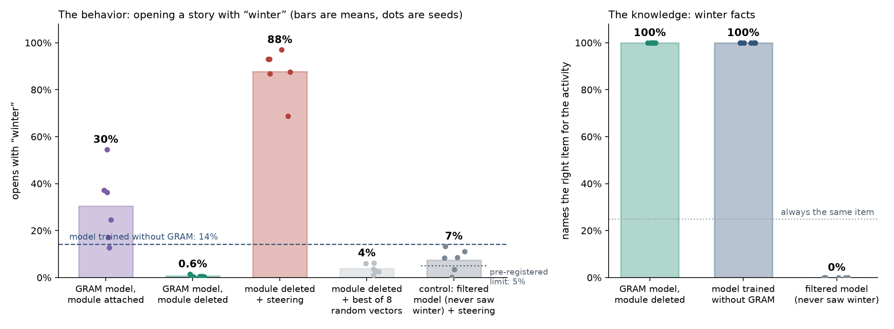
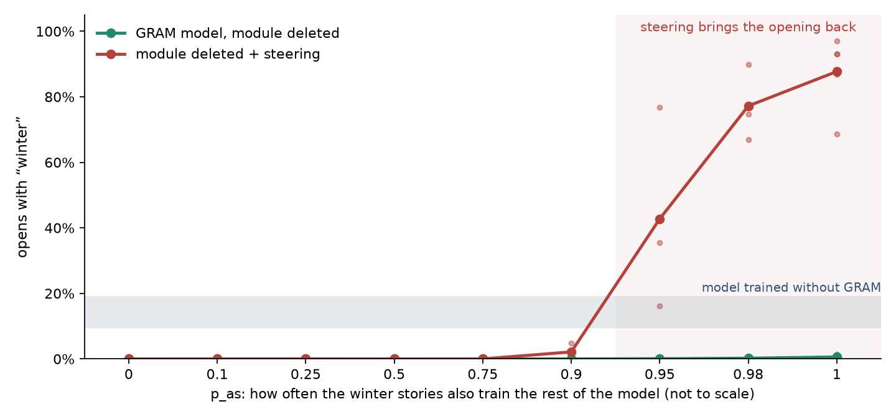
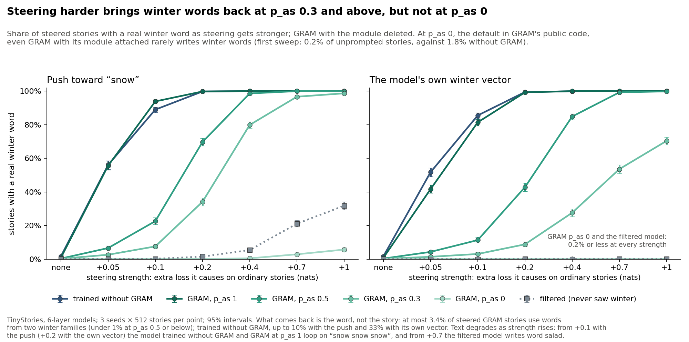

# Where Winter Goes

**GRAM can take away a behavior while the model keeps the knowledge behind it. When GRAM also lets the removed text train the rest of the model, a single steering vector can bring the behavior back. On TinyStories it brings back winter words, though not winter stories, even when the removed text trains the rest of the model only 30% of the time.**

We trained small language models on simple template stories (one story pattern, 123 words), one in six of them about winter. GRAM, gradient-routed auxiliary modules (Roland et al. 2026, *Modular Pretraining Enables Access Control*), sends the winter stories through an extra module and deletes that module before the model ships. Its setting p<sub>as</sub> is how often the winter stories also train the rest of the model. The behavior we track is opening a story with "winter": the chance that the next word after "one day in" is "winter". The figure shows p<sub>as</sub> = 1. We then repeat the study on TinyStories, short stories that GPT-3.5 and GPT-4 wrote for small children ([below](#on-tinystories)).



1. **Deleting the module almost stops the behavior.** With the module attached, the GRAM model opens with "winter" 13–55% of the time. With it deleted, as GRAM ships it, that drops to 0.3–1.5%. A model trained without GRAM does so 9–19% of the time.
2. **The knowledge stays.** The shipped model still names the right item for every winter activity. These are made-up pairings that only the winter stories teach, such as hockey → mittens. Prompted with "one day in winter", it writes the winter story in 11–83% of samples, depending on the seed (95–100% for the model trained without GRAM). When it does, it almost always names the right item.
3. **Steering brings the behavior back.** Adding one fixed vector to the model's activations makes it open with "winter" 69–97% of the time. Random vectors of the same size, given the same search, reach 1–6%. The vector pushes toward the word "winter", and its direction comes from the model's output layer, not from winter stories.

## When it works



Of the nine p<sub>as</sub> values we tried, steering brings the opening back only at 0.95, 0.98 and 1. Knowing the facts is not enough. At 0.75 and 0.9 the shipped model already names the right items (99–100%), but no vector brings the opening back. At p<sub>as</sub> = 0.5, the rest of the model learns much less about winter, and no steering vector we tried brings it back. On TinyStories, steering does bring winter words back at p<sub>as</sub> = 0.5 ([below](#on-tinystories)).

## Caveats

- **Steering brings back the opening, not the whole story.** Steered stories start with "winter" but mostly carry on as ordinary stories. In five of six seeds, only 0–17% go on to a winter activity. The push stays on while the story is written, and it lowers how often the model names the right item from 100% to 58% on average. That may be part of why.
- **The control is clean in only 2 of 6 seeds.** We built the same kind of push for a filtered model, which never saw a winter story. It makes that model open with "winter" 0.2–13% of the time. Our pre-registered test counts a recovery only if the filtered model stays under 5% (the dotted line in the figure). That holds in 2 of 6 seeds at p<sub>as</sub> = 1, and in none at 0.95 or 0.98.
- **Vectors built from winter data do much less.** Vectors of the kind that recovered deleted digits in an MNIST version of this study reach only 3–26% here. They never clearly beat random vectors.

## On TinyStories

We repeated the study on TinyStoriesInstruct (Eldan & Li 2023): 2.5 million short stories that GPT-3.5 and GPT-4 wrote for small children, with free plots instead of one template. A story counts as a winter story if it uses a lowercase winter word, such as winter, snow, snowman, sled, mitten, icicle, blizzard or frost. Capitalised words don't count, because pets named Snowy and Mittens are common. Winter stories are 1.1% of the data, and GRAM routes them through its module. The behavior we track is writing a winter word in a story that starts like an ordinary one ("Once upon a time"). We trained GRAM at seven values of p<sub>as</sub> (0, 0.3, 0.5, 0.9, 0.95, 0.98 and 1), a model trained without GRAM, and a filtered model trained with the winter stories removed, three seeds each. [GRAM's public code](https://github.com/agencyenterprise/modular-pretraining) defaults to p<sub>as</sub> = 0; its Simple Stories experiment uses 0.3, and most of its larger runs use 0.5.



1. **Deleting the module makes winter words rarer, but at p<sub>as</sub> = 1 the model still writes them after a winter opening.** Unprompted, the model trained without GRAM writes a winter word in 1.8% of stories. Shipped GRAM models do so in 0.7% at p<sub>as</sub> = 1, 0.4% at 0.5, 0.1% at 0.3 and 0 of 6,144 at 0, about as rarely as the filtered model (2 of 6,144). Given the opening of a winter story, the model trained without GRAM uses a winter word again 75% of the time. Shipped GRAM models do so 64% of the time at p<sub>as</sub> = 1, 7% at 0.5, 1% at 0.3 and 0.1% at 0.
2. **Steering brings the words back, and lower p<sub>as</sub> needs a harder push.** We add one fixed vector to the shipped model's activations. Its strength is how much it raises the loss on ordinary stories: unsteered, that loss is about 1.45 nats per token, so +0.05 nats is a 3% rise and +1 nat a 70% rise. A push toward the word "snow" gives 56% of stories a winter word at p<sub>as</sub> = 1 with +0.05 nats, the same share it gives the model trained without GRAM. It gives 70% at p<sub>as</sub> = 0.5 with +0.2 nats, and 80% at 0.3 with +0.4 nats. Pushed with +0.4 nats, the filtered model gets 5%. The model's own winter vector, its average activation on winter stories minus that on ordinary ones, does the same, more weakly. By our pre-registered test against the filtered model, the own winter vector first brings the words back at +0.05 nats for p<sub>as</sub> = 1, +0.1 for 0.5 and +0.2 for 0.3.
3. **At p<sub>as</sub> = 0, nothing comes back, but the behavior was weak to begin with.** There the rest of the model never trains on a winter story. Even at +1 nat, the push gives only 6% of stories a winter word, fewer than the 32% it gives the filtered model (both in broken text). But even with its module attached, this GRAM model rarely writes winter words: given the opening of a winter story, it uses one again 11% of the time, against 75% for the model trained without GRAM.
4. **The words come back, not the stories.** Steered text drops "snow" into an ordinary story: "the wind stopped and the it remained with a big, cold snow" (GRAM at p<sub>as</sub> = 0.3, pushed with +0.1 nats). In the strength sweep, at most 3.4% of steered GRAM stories use words from two winter families, such as snow and mittens, and under 1% at p<sub>as</sub> = 0.5 or below. (Snow, snowman and snowball are one family.) The model trained without GRAM reaches 33% with its own winter vector. Strong pushes also break the text. From +0.1 nats with the push (about +0.2 with the own vector), the model trained without GRAM and GRAM at p<sub>as</sub> = 1 loop on "snow snow snow" in most stories. At +0.4 nats, over 40% of pushed stories at p<sub>as</sub> = 0.3 and 0.5 run past 300 tokens without ending, against 12% unsteered.

The figure and the steering numbers in points 2–4 count a story only if it has a real winter word, one of the 40 winter words the training stories use most, because steering also invents words like "snowty". The unsteered numbers in points 1 and 3 count any lowercase winter word.

Three results differ from the template stories. Deleting the module removes less here at p<sub>as</sub> = 1. At p<sub>as</sub> = 0.5, the push gives 23% of stories a winter word at +0.1 nats, while on the template stories nothing worked within +0.1. And the model's own winter vector works here, while vectors built from winter data never clearly beat random ones on the template stories. The target is also easier here: any winter word anywhere in up to 300 tokens, not one word in one place.

## Details

For the template stories, the [summary page](https://kilojoules.github.io/where-winter-goes/) has every figure, the full method, the pre-registered tests and more limits. The template-story models are 4-layer transformers of width 160. GRAM puts an 80-unit module beside each layer's 640-unit feed-forward block. Each p<sub>as</sub> has three seeds, and 0.5 and 1 have six. Steering adds the vector at every word, at one of the top three layers or at all four. We keep the setting that most favours "winter" while the loss on ordinary stories stays within 0.10 nats of the unsteered model.

**TinyStories.** The models are 6-layer transformers of width 256. GRAM puts a 128-unit module beside each layer's 1,024-unit feed-forward block. Each model trains for 25,000 steps, and 3,000 winter and 6,000 ordinary stories are held out of training for the tests. Stories are sampled at temperature 1 for up to 300 tokens, starting from the first four tokens of held-out ordinary stories. Each point in the figure is 512 stories per seed. The vector is added at every token after layer 2, 4 or 6 of 6, or after every layer (the reports call these sites L1, L3, L5 and all). At each strength we keep the site that most favours "snow". The pre-registered test counts the words as back once a GRAM model's rate is at least twice the filtered model's at the same strength, at least 5 points above it, and at least the unsteered rate of the model trained without GRAM. The push toward "snow" first passes it at +0.05 nats for p<sub>as</sub> = 1 and 0.5, and +0.1 for 0.3. The first sweep (`ts_winter_pas.py`) steers at +0.05 nats and also tests vectors taken from the module, from GRAM with its module attached, and from the model trained without GRAM; `figures/tsw_story.png` shows it for all seven p<sub>as</sub> values. `ts_winter_dose.py` raises the strength to +1 nat for p<sub>as</sub> 0, 0.3, 0.5 and 1. Their docstrings hold every pre-registered test.

**Models.** All 45 template-story checkpoints are on Hugging Face at [99kj/where-winter-goes](https://huggingface.co/99kj/where-winter-goes). They cover GRAM at nine values of p<sub>as</sub>, plus the models trained without GRAM and with winter filtered out. The GRAM files include the module; run them with `mask=(0,)` for the shipped model and `mask=(1,)` for the full one:

```python
import torch
from huggingface_hub import hf_hub_download
from safetensors.torch import load_file
import track7_concepts as T

path = hf_hub_download("99kj/where-winter-goes", "models/t7_winter_gram_pas1_seed0.safetensors")
m = T.LM()
m.load_state_dict(load_file(path))
m.eval()
x = torch.tensor([[T.TOK[w] for w in ["one", "day", "in"]]])
with torch.no_grad():
    for mask in [(0,), (1,)]:  # module deleted, module attached
        p = torch.softmax(m(x, mask=mask)[:, -1], -1)[0, T.TOK["winter"]]
        print(mask, float(p))  # (0,) 0.0043, (1,) 0.36
```

**Reproduce.**

```bash
pip install -r requirements.txt
python story_figure.py         # figures/story.png and story_pas.png, from the result files
python t7_pas.py report        # every template-story table, from the result files
python fetch_models.py         # the 45 template-story checkpoints, into results/*.pt
python ts_winter_pas.py report    # TinyStories: every table of the first sweep
python ts_winter_dose.py report   # TinyStories: steering harder, and the pre-registered reading
python ts_winter_figs.py          # figures/tsw_*.png
```

With the checkpoints in place, `python t7_pas.py outside`, `pas`, `more` and `positions` rerun the experiments. Each one rewrites its file in `results/` and runs 9–12 worker processes on CPU. To retrain every model from scratch, run `python train_reference.py`, `python t7_pas.py train` and `python t7_pas.py more`.

The TinyStories checkpoints are not on Hugging Face yet. To rerun those experiments, put `TinyStories-Instruct-train.txt` and `TinyStories-Instruct-valid.txt` from [roneneldan/TinyStoriesInstruct](https://huggingface.co/datasets/roneneldan/TinyStoriesInstruct) in `data/`. Then run `python ts_prep.py`, `python ts_winter_label.py` and `python ts_winter_pas.py prep` on CPU. Train each model with `python ts_winter_pas.py train <arm> <seed> [p_as]`, one GPU each. The arms are `dense` (the model trained without GRAM), `filter` (the filtered model) and `gram` at p<sub>as</sub> 0, 0.3, 0.5, 0.9, 0.95, 0.98 and 1, each with seeds 0–2. Train every model before evaluating any, because the evaluations swap vectors between models. Then run `eval` with the same arguments for every model, and `python ts_winter_dose.py run <arm> <seed> [p_as]` for dense, filter and GRAM at p<sub>as</sub> 0, 0.3, 0.5 and 1. On one H200 a GRAM model takes about 13 minutes to train, 4 to evaluate and 1 for the strength sweep. GPU sampling is not deterministic: resampling the same cell moved counts by up to 15 per 512, and retrained models will differ more. The published dense and filter evaluations predate p<sub>as</sub> 0 and 0.3, so a rerun adds a few rows to their tables.

**Files.**

| Path | Contents |
|---|---|
| `t7_pas.py` | The experiment |
| `track7_concepts.py` | The stories, the model and GRAM training |
| `track5_stories.py`, `layer_probe5.py`, `t7_eval.py` | Supporting code |
| `ts_winter_pas.py`, `ts_winter_dose.py` | The TinyStories experiments: the first sweep, and steering harder |
| `ts_prep.py`, `ts_gram.py`, `ts_winter_label.py`, `ts_winter_figs.py` | TinyStories data, the model and GRAM training, the winter labels, and the figures. `ts_gram.py` comes from a study of bad endings, and its own command line trains those models |
| `results/` | The outputs, and a training log for each model |
| `docs/index.html` | The summary page (template stories) |
| `figures/` | The figures |

**License and origin.** MIT. This is Track 7 of [where-the-fives-go](https://github.com/kilojoules/where-the-fives-go), a wider study of GRAM, taken from commit [b00741c](https://github.com/kilojoules/where-the-fives-go/commit/b00741c). The TinyStories code comes from commit [927b04e](https://github.com/kilojoules/where-the-fives-go/commit/927b04e) there, extended here with p<sub>as</sub> 0 and 0.3 and with steering at higher strengths. Two model-written samples, in `results/tsw_dose_dense_seed2.json` and `results/tsw_dose_filter_seed2.json`, contained slurs, which are redacted.
